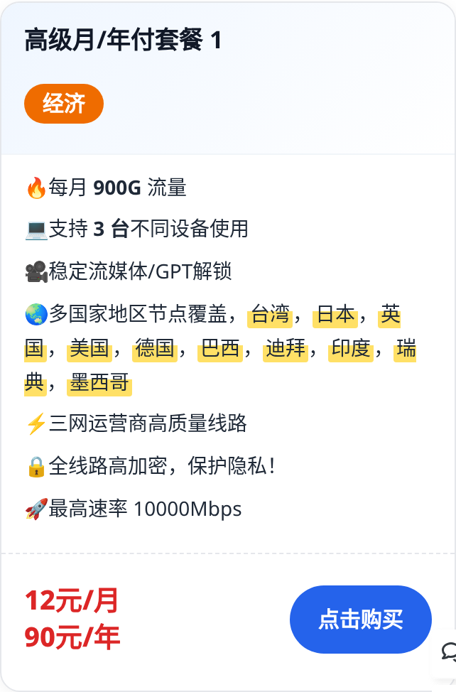
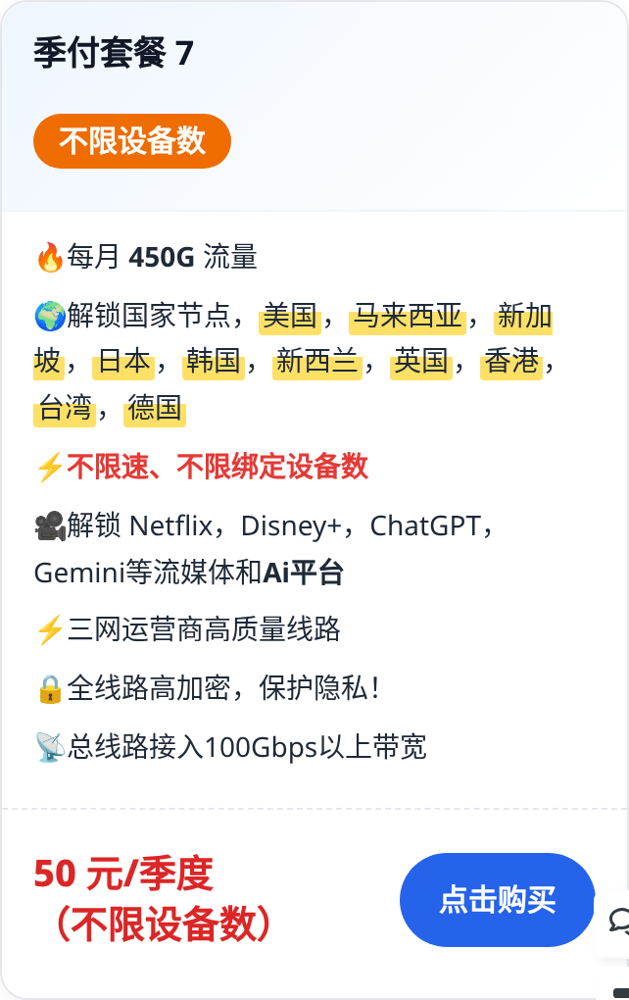

# 科技喵仔 机场套餐服务表 ✈️

> 10 种套餐任君选择，总有一款适合您。最低 **45 元/年**。
> 🎬 25 秒宣传片和完整服务表见博客原文：<https://www.kejimiaozai.com/archives/662>

支持 iPhone / iPad、Mac、安卓 / 鸿蒙、Windows（不支持 Win7 及以下）、软路由。

## 📊 套餐总览

| 分组 | 套餐 | 流量 | 设备 | 价格 | 跳转 |
|---|---|---|---|---|---|
| 经济 | 高级月/年付 1 | 900G/月 | 3 台 | 12 元/月 · 90 元/年 | [跳转](https://tz.kejimiaozai.com/buy/1) |
| 经济 | 年付 2 | 190G/月 | 3 台 | 45 元/年 | [跳转](https://tz.kejimiaozai.com/buy/4) |
| 经济 | 不限时 3 | 一次性 200G / 2000G | 5 台 | 30 元 200G · 130 元 2000G | [跳转](https://tz.kejimiaozai.com/buy/7) |
| Pro | 季付 7 | 450G/月 | 不限 | 50 元/季度 | [跳转](https://tz.kejimiaozai.com/buy/8) |
| Pro | 年付 8 | 450G/月 | 5 台 | 99 元/年 | [跳转](https://tz.kejimiaozai.com/buy/6) |
| Pro | 月付 9 | 1000G/月 | 20 台 | 19 元/月 | [跳转](https://tz.kejimiaozai.com/buy/9) |
| Pro Max | 日本原生独享 0 | 100G/月 | 3 台 | 18 元/月 · 179 元/年 | [跳转](https://tz.kejimiaozai.com/buy/38) |
| Pro Max | 家宽月付 4 | 1000G/月 | 多设备 | 21 元/月 · 100 元/半年 | [跳转](https://tz.kejimiaozai.com/buy/10) |
| Pro Max | 月付专线 5 | 100G/月 | 3 台 | 26 元/月 | [跳转](https://tz.kejimiaozai.com/buy/3) |
| Pro Max | 半年付专线 6 | 120G/月 | 5 台 | 138 元/半年 | [跳转](https://tz.kejimiaozai.com/buy/5) |

## 💰 经济

### 高级月/年付套餐 1
- 🔥 每月 900G 流量，支持 3 台设备
- 🎥 稳定流媒体 / GPT 解锁
- 🌏 节点：**台湾**、**日本**、**英国**、**美国**、**德国**、**巴西**、**迪拜**、**印度**、**瑞典**、**墨西哥**
- ⚡️ 三网高质量线路，最高 10000Mbps，全线路加密

**价格：12 元/月 · 90 元/年**　👉 [点击跳转](https://tz.kejimiaozai.com/buy/1)

### 年付套餐 2
- 🔥 每月 190G 流量，支持 3 台设备
- 🎥 稳定流媒体 / GPT 解锁
- 🌍 节点：**台湾**、**日本**、**英国**、**美国**、**德国**、**巴西**、**迪拜**、**印度**、**瑞典**、**墨西哥**
- ⚡️ 三网高质量线路，最高 10000Mbps，全线路加密

**价格：45 元/年**　👉 [点击跳转](https://tz.kejimiaozai.com/buy/4)

### 不限时套餐 3 `hot升级`
- 🔥 一次性不限时流量，支持 5 台设备
- 🌏 节点：**台湾**、**香港**、**新加坡**、**日本**、**美国**、**韩国**、**德国**、**英国**
- ⚡️ 直连 + 中转线路，ChatGPT 解锁，下载专用节点 0.1x
- 📡 最高 10000Mbps，全线路加密

**价格：30 元 200G · 130 元 2000G**　👉 [点击跳转](https://tz.kejimiaozai.com/buy/7)

## 🚀 Pro

### 季付套餐 7 `不限设备数`
- 🔥 每月 450G 流量，不限速、不限绑定设备数
- 🌍 节点：**美国**、**马来西亚**、**新加坡**、**日本**、**韩国**、**新西兰**、**英国**、**香港**、**台湾**、**德国**
- 🎥 解锁 Netflix、Disney+、ChatGPT、Gemini
- 📡 总线路 100Gbps 以上带宽，全线路加密

**价格：50 元/季度**　👉 [点击跳转](https://tz.kejimiaozai.com/buy/8)

### 年付套餐 8 `Ai类优化`
- 🔥 每月 450G 高速流量，支持 5 台设备
- 😊 晚高峰稳定速率保障
- 🎥 解锁 Netflix、Disney+、ChatGPT、Gemini
- 🌍 节点：**美国**、**马来西亚**、**新加坡**、**日本**、**韩国**、**新西兰**、**英国**、**香港**、**台湾**、**德国**
- 🔒 无活动日志和连接日志，峰值 2000Mbps 以上

**价格：99 元/年**　👉 [点击跳转](https://tz.kejimiaozai.com/buy/6)

### 月付套餐 9 `Ai类优化 大流量`
- 🔥 每月 1000G 高速流量，支持 20 台设备
- 😊 晚高峰稳定速率保障
- 🎥 解锁 Netflix、Disney+、ChatGPT、Gemini
- 🌍 节点：**美国**、**马来西亚**、**新加坡**、**日本**、**韩国**、**新西兰**、**英国**、**香港**、**台湾**、**德国**
- 🔒 无活动日志和连接日志，峰值 2000Mbps 以上

**价格：19 元/月**　👉 [点击跳转](https://tz.kejimiaozai.com/buy/9)

## 👑 Pro Max

### 日本原生独享高质量 IP 套餐 0 `Ai 电商 社交优选`
- 🔥 每月 100G 流量，支持 3 台设备
- 🌏 原生固定 **日本** 节点，IP 质量高
- 🚀 独享带宽 100Mbps，三网回国线路
- 🎥 Netflix、电商外贸；🤖 GPT / Gemini / Claude 解锁

**价格：18 元/月 · 179 元/年**　👉 [点击跳转](https://tz.kejimiaozai.com/buy/38)

### 家宽月付套餐 4 `台湾家宽ip`
- 🔥 每月 1000G（有效期内每月自动刷新）
- 🌏 **台湾** 家庭宽带 IP；节点：**台湾**、**日本**、**美国**、**香港**
- ⚡️ CN2 + BGP 专线，多设备同时使用
- 🎥 Netflix、电商外贸；🤖 GPT / Gemini / Claude 解锁；定期清除日志

**价格：21 元/月 · 100 元/半年**　👉 [点击跳转](https://tz.kejimiaozai.com/buy/10)

### 月付套餐 5 `专线`
- 🔥 每月 100G，全 IEPL 专线节点，支持 3 台设备
- 🌏 节点：**英国**、**台湾**、**香港**、**美国**、**日本**、**新加坡**
- 🎥 稳定流媒体 / GPT 解锁，总带宽 100Gbps 以上

**价格：26 元/月**　👉 [点击跳转](https://tz.kejimiaozai.com/buy/3)

### 半年付套餐 6 `专线`
- 🔥 每月 120G，全 IEPL 专线线路，支持 5 台设备
- 🌏 节点：**英国**、**台湾**、**香港**、**美国**、**日本**、**新加坡**
- 🎥 稳定流媒体 / GPT 解锁，总带宽 100Gbps 以上

**价格：138 元/半年**　👉 [点击跳转](https://tz.kejimiaozai.com/buy/5)

## 🖼️ 套餐卡截图

 

## 📚 客户端教程

| 设备 | 教程 |
|---|---|
| iPhone / iPad | [Shadowrocket](https://www.kejimiaozai.com/archives/38) · [Clash](https://www.kejimiaozai.com/archives/1002) · [Clash Mi](https://www.kejimiaozai.com/archives/976) |
| Mac | [Clash](https://www.kejimiaozai.com/archives/1002) · [Clash Verge](https://www.kejimiaozai.com/archives/678) |
| 安卓 / 鸿蒙 | [FlClash](https://www.kejimiaozai.com/archives/1090) · [Clash Meta](https://www.kejimiaozai.com/archives/670) |
| Windows | [Clash Verge](https://www.kejimiaozai.com/archives/679) |
| 软路由 | [软路由教程](https://kejimiaozai.com/archives/871) |

## ❓ 常见问题
- **套餐**：订阅后不可更改套餐；流量按周期重置，未用完不结转。
- **网络**：先更新订阅；节点异常可换 DNS、重启光猫、切换 5G/Wi-Fi。
- **速率**：直连线路，入口 Azure / AWS 亚太；电信推荐美国凤凰城，移动联通推荐日本。

---
> ⚠️ 价格以[博客原文](https://www.kejimiaozai.com/archives/662)与[商店](https://tz.kejimiaozai.com)为准。更新日期：2026-10-31
